# ☁️ Vendor Payments Cloud Data Platform


AWS cloud and warehouse layer for the Vendor Payments Data Platform.

The platform keeps **Batch** and **Streaming** as independent processing paths while using shared AWS services for storage, serverless query, warehouse loading, analytics, and cross-layer validation.

Batch publishes trusted Gold marts to Amazon S3, validates S3 metrics with Amazon Athena, loads curated outputs into Amazon Redshift Serverless, and reconciles summary and grouped metrics across both systems.

Streaming publishes one completed bounded window at a time, validates S3 and Redshift metrics, and exposes the latest fully completed window through `latest.json` for downstream serving.

---

## 📌 Project Summary

The Cloud Data Platform owns:

- Amazon S3 publishing and storage conventions
- Batch Gold cloud publishing
- Per-window Streaming curated publishing
- Amazon Athena external tables and validation SQL
- Amazon Redshift landing tables, COPY operations, and analytics views
- Batch Athena ↔ Redshift summary validation
- Batch Athena ↔ Redshift grouped validation
- Streaming Athena ↔ Redshift validation
- Redshift runtime metadata generation
- Streaming `latest.json` publication
- Automated tests, Ruff linting, and GitHub Actions CI

Responsibility boundary:

```text
Batch ETL / Kafka Streaming
→ produce validated upstream outputs

Cloud Data Platform
→ Amazon S3
→ Amazon Athena
→ Amazon Redshift
→ cross-layer validation
→ runtime metadata
→ latest.json

Airflow
→ orchestrates Cloud-owned scripts and SQL
```

The Cloud repository owns the implementation. Airflow owns execution order.

---

## 🧭 Architecture

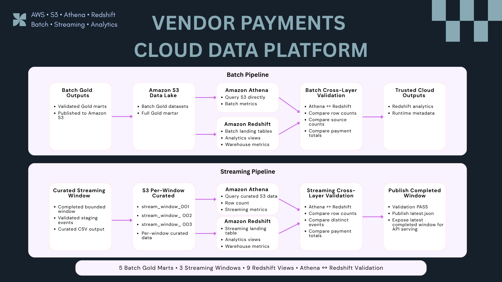

```text
BATCH

Batch Gold
→ Amazon S3
├──→ Amazon Athena
└──→ Amazon Redshift
        ↓
Summary Cross-Layer Validation
        ↓
Grouped Cross-Layer Validation
        ↓
Trusted Batch Analytics


STREAMING

Completed Bounded Window
→ Per-Window Curated CSV
→ Amazon S3
├──→ Amazon Athena
└──→ Amazon Redshift
        ↓
Streaming Cross-Layer Validation
        ↓
Publish latest.json
```

Batch and Streaming remain independent lifecycles. They share S3, Athena, Redshift, and the same cross-layer validation principle without being merged into one data flow.

---

## 📊 Validated Results

| Metric | Result |
| --- | ---: |
| Batch Gold marts | 5 |
| Redshift Batch landing tables | 5 |
| Redshift Batch landing rows | 2,944 |
| Redshift Batch analytics views | 5 |
| Redshift Streaming landing tables | 1 |
| Streaming events loaded | 100,000 |
| Distinct Streaming event IDs | 100,000 |
| Duplicate Streaming event IDs | 0 |
| Missing Streaming event IDs | 0 |
| Redshift Streaming analytics views | 4 |
| Total Redshift analytics views | 9 |
| Batch summary cross-layer validation | PASS |
| Batch grouped cross-layer validation | PASS |
| Batch grouped validation rows | 108 |
| Streaming cross-layer validation | PASS |
| Automated tests | 34 passed |
| Ruff linting | PASS |

Current validation evidence is from the local portfolio environment and configured AWS resources. It is not a production benchmark.

---

## 🪣 Amazon S3 Data Lake

### Batch Gold

```text
data-platform/vendor-payments/gold/full/
├── mart_fund_category_summary/
├── mart_pending_by_department/
├── mart_spending_by_department/
├── mart_spending_by_fiscal_year/
└── mart_spending_by_supplier_top_n/
```

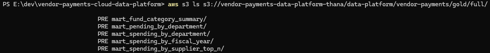

The Batch path publishes five trusted Gold marts under a stable S3 prefix.

### Streaming Curated Output

```text
data-platform/vendor-payments/streaming/curated/
├── stream_window_<NNN>/
│   └── vendor_payments_streaming_events.csv
└── latest.json
```

Current S3 evidence shows:

```text
stream_window_003/
latest.json
```

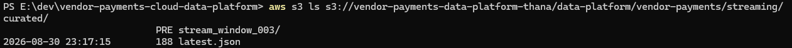

Each completed Streaming window keeps its own curated S3 location instead of overwriting one fixed object.

---

## 🔎 Amazon Athena

Amazon Athena provides serverless SQL access directly over curated S3 data.

Its main role in this project is independent cross-layer validation:

```text
S3 data
→ Athena metrics

Redshift landing
→ Redshift metrics

Athena ↔ Redshift
→ compare
→ PASS / FAIL
```

This prevents a successful warehouse load from being treated as proof that S3 and Redshift are consistent.

---

## 🔁 Batch Summary Cross-Layer Validation

The Batch summary validation compares key metrics for selected Gold marts between Athena and Redshift.

Validated fields include:

```text
dataset_name
row_count
source_record_count
total_vouchers_paid
total_vouchers_pending
total_encumbrance_balance
```

Counts are compared exactly.

Monetary values use controlled decimal tolerance to handle representation differences between CSV-based Athena reads and Redshift decimal storage.

Latest result:

```text
Batch cross-layer validation: PASS
```

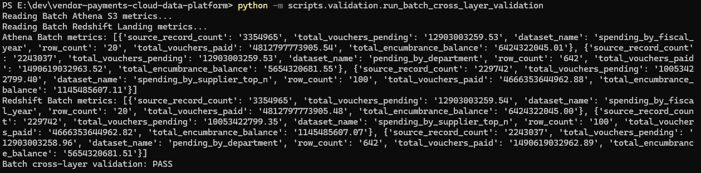

This validation confirms that warehouse ingestion preserves both record-level counts and important financial totals.

---

## 🧩 Batch Grouped Cross-Layer Validation

Summary totals can match while individual business groups are still wrong.

To strengthen validation, the Batch path also compares grouped metrics between Athena and Redshift.

Grouping dimensions:

```text
fiscal_year
department
fund_category
```

Validated grouped fields:

```text
group_type
group_value
group_row_count
source_record_count
total_vouchers_paid
total_vouchers_pending
total_encumbrance_balance
```

The grouped comparator aligns Athena and Redshift rows by:

```text
(group_type, group_value)
```

and fails when required keys differ, counts differ, or monetary differences exceed the configured tolerance.

Latest verified result:

```text
Athena grouped row count:   108
Redshift grouped row count: 108

Batch grouped cross-layer validation: PASS
```

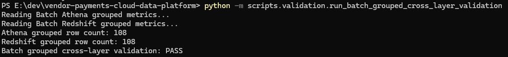

The grouped validation adds a stronger consistency gate than grand totals alone.

---

## 🌊 Streaming Cross-Layer Validation

The Streaming path validates one completed bounded window at a time.

For the selected window, Athena is pointed at the matching S3 curated location and compared with Redshift landing metrics.

Validated metrics:

```text
row_count
distinct_event_count
total_payment_amount
```

Latest verified window:

```text
stream_window_003
```

Latest result:

```text
Athena row_count              = 100000
Redshift row_count            = 100000

Athena distinct_event_count   = 100000
Redshift distinct_event_count = 100000

Streaming cross-layer validation: PASS
```

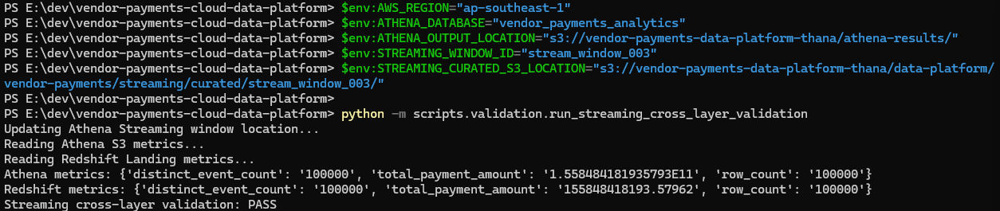

This confirms that the selected curated Streaming window is consistent across S3 and Redshift.

---

## 🏢 Amazon Redshift Serverless

The warehouse separates stored datasets from reusable analytics logic:

```text
landing
analytics
```

Landing tables retain trusted loaded outputs.

Analytics views provide business and event-level logic without duplicating stored datasets.

### Batch Warehouse Validation

```text
landing_table_count  = 5
landing_total_rows   = 2944
analytics_view_count = 5
validation_status    = PASS
```

Validated Batch landing rows:

| Landing Table | Rows |
| --- | ---: |
| `fund_category_summary` | 1,061 |
| `pending_by_department` | 642 |
| `spending_by_department` | 1,121 |
| `spending_by_fiscal_year` | 20 |
| `spending_by_supplier_top_n` | 100 |
| **Total** | **2,944** |

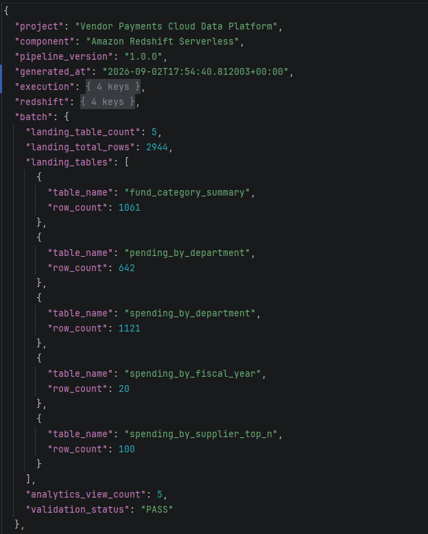

### Streaming Warehouse Validation

```text
landing_table_count   = 1
total_rows            = 100000
rows_with_event_id    = 100000
distinct_event_ids    = 100000
duplicate_event_ids   = 0
missing_event_ids     = 0
analytics_view_count  = 4
total_events          = 100000
total_distinct_events = 100000
validation_status     = PASS
```

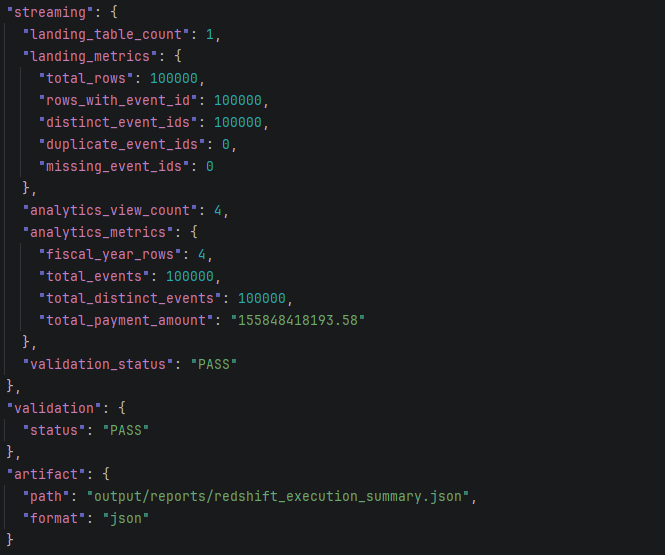

The Streaming warehouse checks verify both row completeness and event-ID uniqueness.

---

## 🧾 Runtime Metadata

Redshift execution metadata is generated by:

```text
scripts/warehouse/generate_redshift_summary.py
```

Generated artifact:

```text
output/reports/redshift_execution_summary.json
```

The report records project identity, execution timestamps, runtime, Redshift configuration, Batch and Streaming warehouse metrics, validation state, and artifact metadata.

The file is runtime-generated metadata. Timestamp and runtime values naturally change between executions.

---

## 🧪 Automated Testing and Code Quality

```powershell
python -m pytest -q
python -m ruff check .
```

Latest verified result:

```text
34 passed
All checks passed!
```

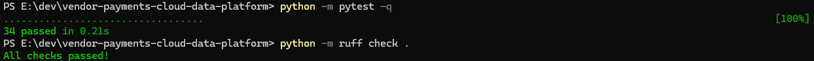

The test suite covers Cloud validation logic, SQL asset expectations, Batch metric comparison, grouped validation, Streaming comparison, runtime metadata behavior, and project structure.

---

## ⚙️ Continuous Integration

GitHub Actions validates the repository on configured pushes and pull requests.

The current CI evidence remains in place until the final multi-repository push. It should then be refreshed with the final successful workflow run.

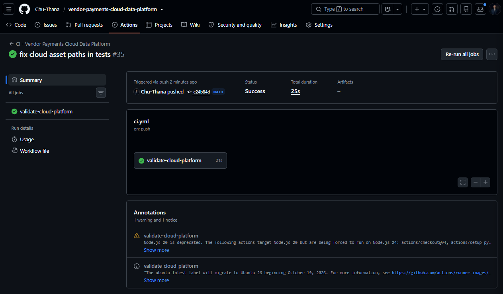

---

## 🔗 Latest Streaming Pointer

The Cloud layer publishes:

```text
data-platform/vendor-payments/streaming/curated/latest.json
```

Current pointer:

```json
{
  "window_id": "stream_window_003",
  "status": "completed",
  "events_s3_key": "data-platform/vendor-payments/streaming/curated/stream_window_003/vendor_payments_streaming_events.csv"
}
```

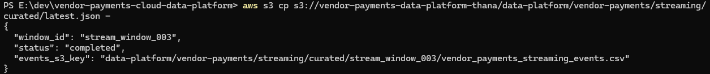

`latest.json` gives downstream serving a stable contract:

```text
Do not infer the latest dataset
from timestamps or folder order.

Read latest.json
→ resolve completed window
→ serve that dataset
```

This avoids hard-coded Streaming S3 paths in downstream systems.

---

## 🗂️ Project Structure

```text
vendor-payments-cloud-data-platform/
│
├── .github/
│   └── workflows/
│       └── ci.yml
│
├── assets/
│   └── cloud-data-platform/
│       ├── 00_cloud_data_platform_architecture.png
│       ├── 01_s3_batch_gold.png
│       ├── 02_s3_streaming_latest_pointer.png
│       ├── 03_athena_batch_cross_layer_validation.png
│       ├── 04_streaming_cross_layer_validation.png
│       ├── 05_redshift_batch_validation.png
│       ├── 06_redshift_streaming_validation.png
│       ├── 07_cloud_tests_and_lint.png
│       ├── 08_cloud_ci_success.png
│       ├── 09_latest_pointer.png
│       └── 10_batch_grouped_cross_layer_validation.png
│
├── scripts/
│   ├── athena/
│   │   └── run_athena_query.py
│   ├── batch/
│   ├── streaming/
│   │   └── publish_latest_streaming_pointer.py
│   ├── validation/
│   │   ├── compare_batch_metrics.py
│   │   ├── compare_grouped_batch_metrics.py
│   │   ├── compare_streaming_metrics.py
│   │   ├── run_batch_cross_layer_validation.py
│   │   ├── run_batch_grouped_cross_layer_validation.py
│   │   ├── run_streaming_cross_layer_validation.py
│   │   └── test_grouped_validation_fail.py
│   └── warehouse/
│       └── generate_redshift_summary.py
│
├── sql/
│   ├── athena/
│   │   ├── 13_validate_batch_gold.sql
│   │   └── 14_validate_batch_grouped.sql
│   └── redshift/
│       ├── 11_validate_batch_metrics.sql
│       └── 12_validate_batch_grouped_metrics.sql
│
├── output/
│   └── reports/
│       └── redshift_execution_summary.json
│
├── tests/
├── .env.example
├── .gitignore
├── pytest.ini
├── requirements.txt
└── README.md
```

---

## ▶️ Run Locally

### 1. Create and activate a virtual environment

```powershell
python -m venv .venv
.venv\Scripts\Activate.ps1
```

### 2. Install dependencies

```powershell
python -m pip install -r requirements.txt
```

### 3. Run tests and Ruff

```powershell
python -m pytest -q
python -m ruff check .
```

### 4. Batch Summary Cross-Layer Validation

```powershell
$env:AWS_REGION="ap-southeast-1"
$env:ATHENA_DATABASE="vendor_payments_analytics"
$env:ATHENA_OUTPUT_LOCATION="s3://vendor-payments-data-platform-thana/athena-results/"

python -m scripts.validation.run_batch_cross_layer_validation
```

### 5. Batch Grouped Cross-Layer Validation

```powershell
python -m scripts.validation.run_batch_grouped_cross_layer_validation
```

### 6. Streaming Cross-Layer Validation

```powershell
$env:STREAMING_WINDOW_ID="stream_window_003"
$env:STREAMING_CURATED_S3_LOCATION="s3://vendor-payments-data-platform-thana/data-platform/vendor-payments/streaming/curated/stream_window_003/"

python -m scripts.validation.run_streaming_cross_layer_validation
```

### 7. Generate Redshift Runtime Metadata

```powershell
python scripts\warehouse\generate_redshift_summary.py
```

Cloud API calls require valid AWS credentials and access to the configured S3, Athena, and Redshift resources.

---

## ☁️ Airflow Integration

The Cloud repository remains independently testable while Airflow invokes Cloud-owned scripts and SQL as bounded orchestration tasks.

```text
Batch Pipeline DAG
→ Upload Batch Gold to S3
→ Redshift Batch processing
→ Batch summary cross-layer validation
→ Batch grouped cross-layer validation

Streaming Pipeline DAG
→ Convert completed window
→ Upload per-window curated output
→ Redshift Streaming processing
→ Streaming cross-layer validation
→ Publish latest.json

Main Platform DAG
→ Check Cloud readiness
→ Generate Redshift summary
→ Validate execution metadata
→ Generate orchestration summary
```

Responsibility remains explicit:

```text
Cloud repository
= implementation

Airflow repository
= orchestration
```

---

## 🔗 Role in the Vendor Payments Data Platform

```text
Batch ETL
→ Batch Pipeline DAG
→ S3
→ Athena + Redshift
→ Summary validation
→ Grouped validation

Kafka Streaming
→ _SUCCESS
→ Streaming Pipeline DAG
→ Per-window S3
→ Athena + Redshift
→ Streaming cross-layer validation
→ latest.json

latest.json
→ FastAPI
→ React / analytics consumers
```

This repository is the cloud storage, serverless query, warehouse-processing, and cross-layer validation layer of the wider Vendor Payments Data Platform.

---

## 🧠 Key Engineering Decisions

### Why keep Batch and Streaming paths separate?

Batch and Streaming have different processing lifecycles and storage units. The Cloud platform provides shared AWS services without forcing both workloads into a single pipeline.

### Why use Athena in addition to Redshift?

A successful Redshift load proves that a warehouse operation completed, not that S3 and Redshift contain equivalent data. Athena provides an independent query path directly over S3.

### Why add grouped validation?

Grand totals can match even when values are assigned to the wrong fiscal year, department, or fund category. Grouped validation checks business-level consistency instead of relying only on global totals.

### Why include `total_encumbrance_balance`?

Financial validation should cover more than paid and pending totals. Adding encumbrance balance strengthens reconciliation between Data Lake and warehouse outputs.

### Why use per-window Streaming S3 paths?

A fixed Streaming object does not represent multiple independently completed processing windows. Window-specific paths preserve lifecycle boundaries and replay traceability.

### Why publish `latest.json`?

Downstream systems should not infer the latest completed window from timestamps, object ordering, or hard-coded keys. `latest.json` is an explicit serving contract.

### Why separate landing tables and analytics views?

Landing tables retain trusted loaded data. Analytics views provide reusable analytical logic without duplicating the stored datasets.

### Why generate runtime metadata?

Machine-readable metadata makes execution state measurable and reusable by orchestration and portfolio evidence instead of relying only on terminal logs.

---

## 🛣️ Planned Improvements

Possible production-oriented extensions include:

- Infrastructure as Code
- Partition-aware S3 and Athena optimization
- Historical per-window retention policies
- Centralized Cloud observability
- Cost monitoring and reporting
- Automated failure alerting
- Stronger environment and secret management
- Additional Redshift performance tuning
- Broader cross-layer metric coverage
- Historical validation result persistence

---

## 🎯 Key Takeaway

```text
Batch
→ 5 Gold Marts
→ S3
→ Athena + Redshift
→ Summary Cross-Layer Validation
→ Grouped Cross-Layer Validation

Streaming
→ Completed Window
→ Per-Window S3
→ Athena + Redshift
→ Cross-Layer Validation
→ latest.json
```

The Cloud Data Platform provides explicit storage boundaries, independent S3-to-warehouse reconciliation, trusted Redshift analytics, grouped business-level validation, machine-readable execution metadata, and a stable serving contract for the latest completed Streaming window.
